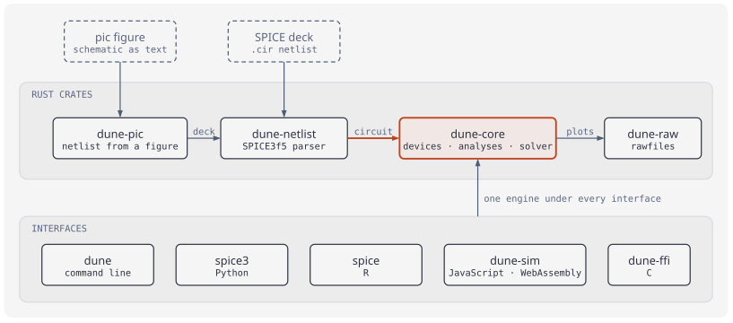
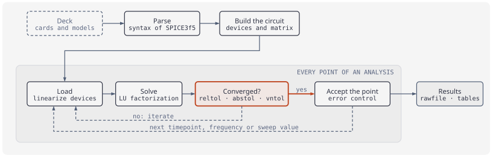

# Dune

**SPICE, reborn in Rust.** Dune is a faithful rewrite of Berkeley's
SPICE3f5 circuit simulator: the same netlists, the same defaults, the
same numbers — validated circuit by circuit against ngspice — with a
clean engine you can call from Python, R, JavaScript or C.

Dune is a derived work: the engine is a translation of the SPICE3f5
sources of the University of California, Berkeley, and some parts
(BSIM3v3.3, the `.sp` analysis, the operating-point fallback chain,
`.measure`, the transient noise sources and the revisions of several
device routines) are derived from [ngspice](https://ngspice.sourceforge.io/)
release 47. See [Credits and lineage](#credits-and-lineage) and
[NOTICE](NOTICE).

**Site: [milkway.github.io/dune](https://milkway.github.io/dune/)** ·
[Examples gallery](https://milkway.github.io/dune/examples/) — every
corpus circuit, simulated · [Known differences](corpus/KNOWN_DIFFS.md)

[](https://github.com/milkway/dune/actions/workflows/ci.yml)
[](https://crates.io/crates/dune-core)
[](https://pypi.org/project/spice3/)
[](https://www.npmjs.com/package/@strategicprojects/dune-sim)
[](https://milkway.github.io/dune/r/)
[](LICENSE)
[](https://doi.org/10.5281/zenodo.24052213)

## Packages

One engine, the same numbers from every one of them.

| | Package | Install | Docs |
|---|---|---|---|
| Python | [`spice3`](https://pypi.org/project/spice3/) (`import spice`) | `pip install spice3` | [PyPI](https://pypi.org/project/spice3/) |
| R | [`spice`](https://milkway.github.io/dune/r/) | `remotes::install_github("milkway/dune", subdir = "r")` | [milkway.github.io/dune/r](https://milkway.github.io/dune/r/) |
| JavaScript / WebAssembly | [`@strategicprojects/dune-sim`](https://www.npmjs.com/package/@strategicprojects/dune-sim) | `npm install @strategicprojects/dune-sim` | [npm](https://www.npmjs.com/package/@strategicprojects/dune-sim) |
| Rust | [`dune-core`](https://crates.io/crates/dune-core), [`dune-netlist`](https://crates.io/crates/dune-netlist), [`dune-raw`](https://crates.io/crates/dune-raw), [`dune-pic`](https://crates.io/crates/dune-pic) | `cargo add dune-core dune-netlist` | [docs.rs](https://docs.rs/dune-core) |
| C | `dune-ffi` (C ABI, `include/dune.h`) | built from this repository | [`crates/dune-ffi`](crates/dune-ffi) |
| Command line | `dune` | `brew install milkway/tap/dune` (macOS, Linux), or the binaries of the [latest release](https://github.com/milkway/dune/releases/latest) | [`crates/dune-cli`](crates/dune-cli) |

## How it fits together



A circuit arrives as a SPICE deck or as a schematic written in pic.
`dune-core` is the only place where circuits are solved; every
package is an interface to it.



Every point of every analysis is a Newton–Raphson loop: linearize the
devices, solve the linear system, test convergence at SPICE's own
tolerances. The sources of both diagrams are pic figures in
[`site/diagrams`](site/diagrams).

## What's inside

- **Every SPICE3f5 device and analysis**: R C L K, V/I sources, E F G H,
  diode, BJT (Gummel–Poon), MOS levels 1–6, BSIM1/2, JFET, MESFET,
  switches, ideal and lossy (LTRA) transmission lines, `.subckt` — and
  `.OP .DC .AC .TRAN .PZ .NOISE .DISTO .TF .SENS`. Plus BSIM3v3.3 and
  S-parameter analysis (`.sp`), both translated from the ngspice-47
  sources.
- **Oracle-tested**: nothing ships until every corpus circuit matches
  pinned ngspice-47 goldens point by point, at SPICE's own tolerances
  (`reltol`/`abstol`/`vntol`). Deliberate divergences are documented in
  [`corpus/KNOWN_DIFFS.md`](corpus/KNOWN_DIFFS.md), each behind a
  measured gate.
- **Schematics in, waveforms out**: Dune reads figures written in
  [rpic](https://rpic.dev)'s pic language and extracts runnable decks
  (`dune pic figure.pic`); the same engine powers the Simulate panel in
  rpic Studio, all client-side WebAssembly.
- **Rawfiles** in SPICE3's own binary and ASCII formats, so existing
  viewers read them unchanged.
- **A more accurate transient by default**: `.tran` integrates with
  TR-BDF2, an L-stable method that does not ring and, on the corpus,
  is closer to the converged answer than the trapezoidal rule at the
  same step; a switch flips at the instant its control crosses the
  threshold, not at the first timepoint past it. `.options
  compat=spice3` restores the SPICE3f5 defaults (the trapezoidal
  rule, switches on the grid), which is what the ngspice oracle
  checks.

## Install

```sh
# Python — PyPI (polars DataFrames, zero-copy numpy; module `import spice`)
pip install spice3

# JavaScript / WebAssembly — npm (runs in the browser)
npm install @strategicprojects/dune-sim

# R — tidy tibbles (CRAN submission planned)
Rscript -e 'remotes::install_github("milkway/dune", subdir = "r")'

# Rust library — crates.io (dune-netlist, dune-raw, dune-core, dune-pic)
cargo add dune-core dune-netlist

# CLI — Homebrew (macOS, Linux). homebrew-core's own `dune` is the
# OCaml build system, so the tap is part of the name
brew install milkway/tap/dune

# CLI — from source (Rust 1.88+)
git clone https://github.com/milkway/dune && cd dune && cargo build --release
```

The Rust crates are 0.x: the public API of `dune-core` may change
between minor versions.

```python
import spice

run = spice.simulate("""
step into a series rlc
V1 in 0 PULSE(0 1 0 1n 1n 1 2)
R1 in n1 60
L1 n1 out 1m
C1 out 0 1n
.tran 0.1u 40u
.end
""")
run.plots[0].df()   # polars DataFrame: time, v(in), v(out)…
```

## Repository layout

| Path | What |
|---|---|
| `crates/dune-core` | The engine: devices, analyses, solver |
| `crates/dune-netlist` | SPICE3f5-faithful netlist parser |
| `crates/dune-raw` | Rawfile reader/writer |
| `crates/dune-pic` | Netlist extraction from pic figures |
| `crates/dune-cli` | The `dune` command |
| `crates/dune-wasm` | WebAssembly bindings (`@strategicprojects/dune-sim`) |
| `crates/dune-ffi` | C ABI |
| `python/`, `r/` | The `spice3` (PyPI) and `spice` (R) packages |
| `corpus/` | SPICE3f5 sources (the reference), test decks, ngspice goldens |
| `site/` | The website and examples gallery |

## Credits and lineage

Dune exists because of the work of others, and is derived from it:

- **SPICE3f5** — © 1985–1991 The Regents of the University of
  California; written at the EECS Department of UC Berkeley by Thomas
  L. Quarles and many others, whose names are in the headers of the
  original files. The netlist language, the device models, the
  numerical methods and the analyses of Dune are translated from it.
  The unmodified sources are in [`corpus/spice3f5`](corpus/spice3f5).
- **ngspice** — the maintained successor of SPICE3f5, by the ngspice
  team and contributors (Modified BSD licence). Dune is validated
  against ngspice-47, and the following are derived from its sources:
  BSIM3v3.3 (`spicelib/devices/bsim3`), the S-parameter analysis `.sp`
  (`span.c`, Alessio Cacciatori), the operating-point fallback chain
  (`cktop.c`, with Alan Gillespie's gmin and source stepping, and
  `optran.c`, Holger Vogt), BSIM1/BSIM2 noise (`b1noi.c`, `b2noi.c`,
  Paolo Nenzi), the `TRNOISE`/`TRRANDOM` sources, `.measure`
  (`com_measure2.c`), the switches as ngspice runs them, and every
  SPICE3f5 routine where Dune follows ngspice's revision (each one is
  named in the module comments and in
  [`corpus/KNOWN_DIFFS.md`](corpus/KNOWN_DIFFS.md)).
- **BSIM3v3.3.0** — © 2004 The Regents of the University of
  California; developed by the UC Berkeley BSIM Research Group
  (JianHui Huang, Min-Chie Jeng, Mansun Chan, Gary W. Ng, Weidong Liu,
  Xuemei Xi).

[NOTICE](NOTICE) lists the upstream files module by module and
reproduces their copyright and licence notices; it ships with every
package.

Dune is an independent project: it is not affiliated with, sponsored by or
endorsed by the University of California, Berkeley, the UC Berkeley BSIM
Research Group or the ngspice project. The names "SPICE", "SPICE3" and
"ngspice" are used only descriptively, to identify the programs whose
netlist language and behaviour Dune implements.
The translation was done with the assistance of AI coding tools.

## License

BSD-3-Clause — © 2026 André Leite; portions derived from SPICE3f5,
© 1985–1991 The Regents of the University of California, and from
ngspice, © 1985–2018 The Regents of the University of California and
others. See [LICENSE](LICENSE) and [NOTICE](NOTICE).
