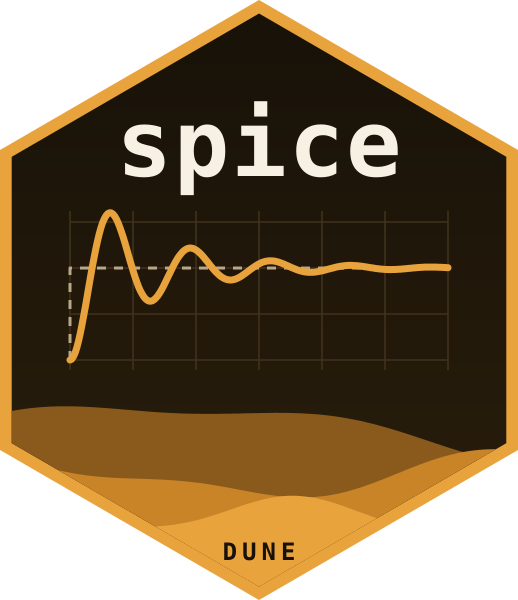

# spice 

<!-- badges: start -->
[](https://github.com/milkway/dune/actions/workflows/ci.yml)
[](https://lifecycle.r-lib.org/articles/stages.html#experimental)
[](https://github.com/milkway/dune/blob/main/LICENSE)
[](https://doi.org/10.5281/zenodo.24052213)
[](https://pypi.org/project/spice3/)
[](https://www.npmjs.com/package/@strategicprojects/dune-sim)
[](https://crates.io/crates/dune-core)
<!-- badges: end -->

spice runs SPICE3 circuit netlists from R and hands the results back
as tidy data. The engine is [Dune](https://github.com/milkway/dune), a
circuit simulator written in Rust and derived from Berkeley SPICE3f5,
checked circuit by circuit against ngspice.

- **Every SPICE3f5 analysis**: operating point, DC sweep, transient,
  AC, pole-zero, noise, distortion, transfer function and sensitivity,
  plus periodic steady state (`spice_pss()`).
- **Every SPICE3f5 device**, and BSIM3v3.
- **Long tibbles** out (`spice_tidy()`), ready for 'ggplot2';
  `autoplot()` for a quick look.
- **Sessions and sweeps**: alter a part and rerun without rebuilding
  (`spice_session()`), or sweep parameters across threads
  (`spice_sweep()`).
- **Decks as chunks**: a knitr engine runs ```` ```{spice} ```` chunks
  in R Markdown and Quarto.
- **Circuits from figures**: `spice_pic()` extracts the netlist of a
  schematic drawn in the pic language.
- **Rawfiles** in SPICE3's own format, to exchange with other
  simulators (`spice_read_raw()`, `spice_write_raw()`).

## Installation

spice is not on CRAN yet. Install the development version from GitHub;
it compiles Rust code, so it needs `cargo` and `rustc` (>= 1.88),
from <https://www.rust-lang.org/tools/install>.

```r
# install.packages("remotes")
remotes::install_github("milkway/dune", subdir = "r")
```

## A first circuit

```r
library(spice)

deck <- "RLC low-pass
vin in 0 pulse(0 1 0 1u) ac 1
r1 in mid 50
l1 mid out 1m
c1 out 0 1u
.tran 2u 1m
.ac dec 50 100 100k
.end"

res <- spice_run(deck)
spice_tidy(res, plots = "Transient Analysis")
```

`vignette("spice")` walks through this deck end to end.

## Faithful to SPICE, and better where it can be measured

Netlist syntax, device models and analyses are SPICE3f5's. Where Dune
departs from it by default, it is because the result is measurably
closer to the converged answer at the same step: a transient
integrates with TR-BDF2 instead of the trapezoidal rule, a switch
flips at the instant its control crosses the threshold, a lossy line
keeps the corners of the waves it carries. One option restores the
SPICE3 behaviour of all of them:

```r
spice_run(deck, options = list(compat = "spice3"))
```

`vignette("defaults")` shows the difference on a small circuit.

## The same engine elsewhere

spice is one of several front ends to Dune; a deck gives the same
numbers in all of them.

| | package | install |
|---|---|---|
| Python | [`spice3`](https://pypi.org/project/spice3/) | `pip install spice3` |
| JavaScript / WebAssembly | [`@strategicprojects/dune-sim`](https://www.npmjs.com/package/@strategicprojects/dune-sim) | `npm install @strategicprojects/dune-sim` |
| Rust | [`dune-core`](https://crates.io/crates/dune-core), with [`dune-netlist`](https://crates.io/crates/dune-netlist), [`dune-raw`](https://crates.io/crates/dune-raw) and [`dune-pic`](https://crates.io/crates/dune-pic) | `cargo add dune-core` |
| Command line | [`dune`](https://github.com/milkway/dune) | built from the repository |

The [circuit gallery](https://milkway.github.io/dune/examples/) shows
every circuit of the engine's test corpus with its results, and
[rpic](https://github.com/milkway/rpic-lang) is the pic-language
implementation behind `spice_pic()`.

## Citing

Dune has a DOI: [10.5281/zenodo.24052213](https://doi.org/10.5281/zenodo.24052213).
`citation("spice")` gives the entry for the package.
