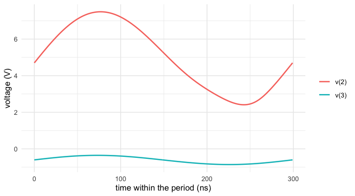
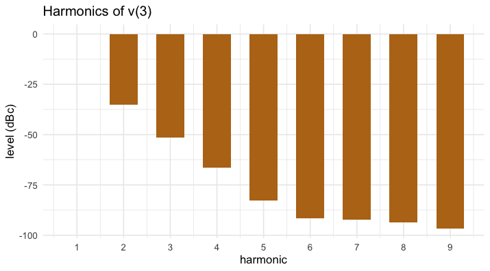

*The results on this page were computed when the vignette was written
(see `vignettes/precompile.R`); the code is what produced them.*


``` r
library(spice)
```

A transient shows an oscillator starting. What one usually wants is
the oscillation itself — its period, amplitude and harmonics — without
waiting for the start-up to die out. `spice_pss()` computes one period
of the steady state directly, by shooting; for an oscillator, with no
source to set the frequency, the period is one of the unknowns.

## A Colpitts oscillator

An LC tank with a capacitive divider around one transistor. The supply
ramp of `vee` kicks it off.


``` r
colpitts <- "colpitts oscillator
.model qnl npn(bf=80 rb=100 ccs=2pf tf=0.3ns tr=6ns cje=3pf cjc=2pf va=50)
r1 1 0 1
q1 2 1 3 qnl
vcc 4 0 5
rl 4 2 750
c1 2 3 500p
c2 4 3 4500p
l1 4 2 5uH
re 3 6 4.65k
vee 6 0 dc -10 pwl 0 0 1e-9 -10
.end"
```

The tank alone would resonate at


``` r
f_tank <- 1 / (2 * pi * sqrt(5e-6 * (500e-12 * 4500e-12) / (500e-12 + 4500e-12)))
f_tank
#> [1] 3355281
```

## The steady state

`osc_node` names the node that oscillates; `tstab` is how long to let
it start before shooting.


``` r
pss <- spice_pss(colpitts, tstab = 500e-6, osc_node = "3", points = 256)
pss
#> <spice_result> colpitts oscillator
#> 2 plots:
#> • Time Domain Periodic Steady State Analysis: 9 variables x 257 points, real, scale time
#> • Frequency Domain Periodic Steady State Analysis: 9 variables x 10 points, complex, scale frequency
#> 4 notes:
#> ℹ pss: no periodic source — autonomous oscillator on v(3); initial period estimate 3.1451586093601e-7 s from the last 4 periods between rising crossings (spread 1.2e-2); mid-range level -6.121373892676961e-1 V, swing 4.763024947781142e-1 V; shooting starts at its last rising crossing, t0 = 4.999770389214005e-4 s
#> ℹ pss: no periodic source — autonomous oscillator on v(3); initial period estimate 2.9873432998080455e-7 s from the last 4 periods between rising crossings (spread 4.7e-3); mid-range level -6.031503213735554e-1 V, swing 5.118206867990793e-1 V; shooting starts at its last rising crossing, t0 = 5.014718978170918e-4 s (refined over 5.5 periods continued from TSTAB at T/POINTS)
#> ℹ pss: autonomous oscillator: period 2.990865634701062e-7 s (frequency 3.343513624944072e6 Hz) is the shooting's result (last Newton correction 3.522e-10 s); [residual/tolerance, T] per iteration: [2.861e0, 2.987343300e-7], [1.557e-2, 2.990865635e-7]; phase condition v(3) = -6.031498239430972e-1 V at t0 = 5.014718978170918e-4 s
#> ℹ pss: 2 shooting iteration(s), residual/tolerance per iteration: 2.861e0, 1.557e-2; 2 adaptive and 5 replayed period transients (GMRES dimensions [4])
#> Periodic steady state (autonomous oscillator): period 2.99087e-07 s from t0 = 0.000501472 s; 2 shooting iterations, residual 0.0156.
1 / pss$period
#> [1] 3343514
```

The transistor's own capacitances add to the tank's and pull the
frequency a little below the bare resonance. One period, straight from the result:


``` r
w <- pss$time[pss$time$variable %in% c("v(2)", "v(3)"), ]
ggplot(w, aes((time - min(time)) * 1e9, value, colour = variable)) +
  geom_line(linewidth = 0.8) +
  labs(x = "time within the period (ns)", y = "voltage (V)", colour = NULL)
```

<div class="figure">

<p class="caption">plot of chunk wave</p>
</div>

## Harmonics

The spectrum comes with the result: harmonic 0 is the mean, 1 the
fundamental.


``` r
sp <- pss$spectrum[pss$spectrum$variable == "v(3)" & pss$spectrum$harmonic > 0, ]
sp$mag <- Mod(complex(real = sp$re, imaginary = sp$im))
sp$dbc <- 20 * log10(sp$mag / sp$mag[1])

ggplot(sp, aes(harmonic, dbc)) +
  geom_col(fill = "#b8741a", width = 0.6) +
  scale_x_continuous(breaks = sp$harmonic) +
  labs(x = "harmonic", y = "level (dBc)", title = "Harmonics of v(3)")
```

<div class="figure">

<p class="caption">plot of chunk spectrum</p>
</div>

## Against the long transient

The same number the slow way: run past the start-up and time the
crossings.


``` r
long <- spice_run(sub(".end", ".tran 1n 600u 597u\n.end", colpitts, fixed = TRUE))
v <- long |> spice_tidy("tran", "v(3)")
mid <- mean(range(v$value))
up <- which(v$value[-1] > mid & v$value[-nrow(v)] <= mid)
t_up <- v$scale[up] + (mid - v$value[up]) / (v$value[up + 1] - v$value[up]) *
  (v$scale[up + 1] - v$scale[up])
c(transient = mean(diff(t_up)), pss = pss$period)
#>    transient          pss 
#> 2.990834e-07 2.990866e-07
```

Six hundred microseconds of transient for what the shooting gets from
a handful of periods, and the two agree to about one part in 1e5.
