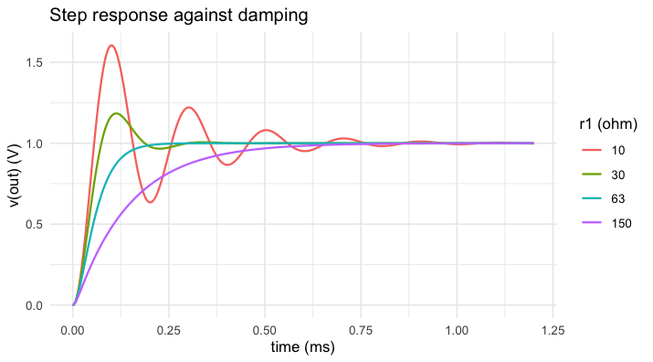
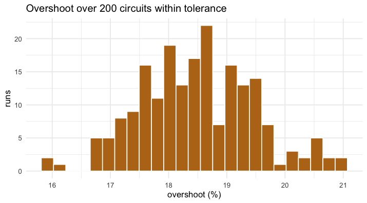

*The results on this page were computed when the vignette was written
(see `vignettes/precompile.R`); the code is what produced them.*


``` r
library(spice)
```

A simulation answers "what does this circuit do". Design asks "what
should the values be" and "what happens when they are off by 5 %".
`spice_sweep()` runs one deck over many parameter sets, in parallel if
asked, and returns everything as one tidy table.

## Choosing the damping

A second-order RLC low-pass. The resistor sets the damping: too little
and the step rings, too much and it crawls.


``` r
rlc <- "rlc low-pass
vin in 0 pulse(0 1 0 1u) ac 1
r1 in mid 50
l1 mid out 1m
c1 out 0 1u
.tran 2u 1.2m
.end"
```

Critical damping is at


``` r
2 * sqrt(1e-3 / 1e-6)
#> [1] 63.24555
```


``` r
sw <- spice_sweep(rlc, r1 = c(10, 30, 63, 150))
tr <- sw |> spice_tidy(vars = "out")

ggplot(tr, aes(scale * 1e3, value, colour = factor(r1))) +
  geom_line(linewidth = 0.7) +
  labs(x = "time (ms)", y = "v(out) (V)", colour = "r1 (ohm)",
       title = "Step response against damping")
```

<div class="figure">

<p class="caption">plot of chunk damping</p>
</div>

## What tolerance does

Fix `r1` at 30 ohm and give all three parts their tolerances: 5 % for
the resistor and the inductor, 10 % for the capacitor. `.mode = "zip"`
takes the vectors row by row instead of crossing them.


``` r
set.seed(42)
n <- 200
mc <- spice_sweep(rlc,
  r1 = rnorm(n, 30, 30 * 0.05 / 3),
  l1 = rnorm(n, 1e-3, 1e-3 * 0.05 / 3),
  c1 = rnorm(n, 1e-6, 1e-6 * 0.10 / 3),
  .mode = "zip", .threads = 4
)
out <- mc |> spice_tidy(vars = "out")
peak <- tapply(out$value, out$run, max)
summary((peak - 1) * 100)
#>    Min. 1st Qu.  Median    Mean 3rd Qu.    Max. 
#>   15.92   17.78   18.46   18.49   19.16   20.97
```


``` r
ggplot(data.frame(overshoot = (peak - 1) * 100), aes(overshoot)) +
  geom_histogram(bins = 25, fill = "#b8741a", colour = "white") +
  labs(x = "overshoot (%)", y = "runs",
       title = "Overshoot over 200 circuits within tolerance")
```

<div class="figure">

<p class="caption">plot of chunk hist</p>
</div>

## Which part matters

The sweep keeps the parameters of every run, so the question is a
regression away.


``` r
runs <- mc$params
runs$overshoot <- as.numeric((peak - 1) * 100)[match(runs$run, as.integer(names(peak)))]
fit <- lm(overshoot ~ scale(r1) + scale(l1) + scale(c1), data = runs)
round(coef(fit), 2)
#> (Intercept)   scale(r1)   scale(l1)   scale(c1) 
#>       18.49       -0.66        0.32       -0.70
```

One standard deviation of each part moves the overshoot by the amount
shown, in percentage points: the resistor and the capacitor weigh
about the same, the inductor half as much and the other way.
